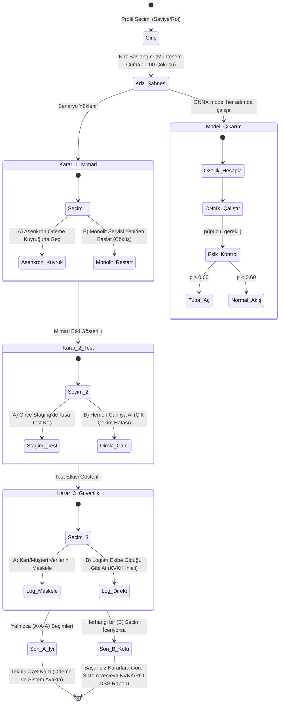

# SE Primer v2 — Proje Spesifikasyonu

## 1. Proje Amacı

**SE Primer**, yüksek trafikli bir e-ticaret altyapısında Muhteşem Cuma gecesi yaşanan ödeme servisi kilitlenmesini simüle eden, mobil öncelikli ve etkileşimli bir eğitim uygulamasıdır.

v2'de oyuncunun davranışından öğrenen küçük, göreve özel bir ML modeli (`model.onnx`) eklendi. Model, oyuncunun o anki karar verileri ışığında Sokratik tutor ipucuna ihtiyaç duyup duymadığını tahmin eder ve buna göre tutor deneyimini otomatik uyarlar.

---

## 2. Kabul Kriterleri (AC)

| ID  | Açıklama |
|-----|----------|
| AC-1 | Onboarding ekranında oyuncu seviyesi seçilebilir (Yeni Başlayan / Deneyimli Mühendis). |
| AC-2 | Kriz ekranında 3 karar adımı sırayla gösterilir; mevcut adımda A veya B kararı vermeden ilerlenemez. |
| AC-3 | Her karar sonrasında konsol terminali ilgili log satırlarını dinamik olarak ekler. |
| AC-4 | Tüm kararlar A ise Son A (Başarılı Kurtarma), herhangi bir B varsa Son B (İhlal Raporu) gösterilir. |
| AC-5 | Sokratik mentor, seçim yapılmadan önce yönlendirici sorular sorar; doğrudan yanıt vermez. |
| AC-6 | Model (`model.onnx`) tarayıcıda `onnxruntime-web` ile çalışır; model kararı oyun davranışını gerçekten değiştirir. |
| AC-7 | `p(ipucu_gerekli) ≥ 0.60` eşiği aşıldığında tutor widget'ı otomatik açılır ve "Dikkat: Bu adım kritik görünüyor" banner'ı gösterilir. |
| AC-8 | Diferansiyel test: `tests/parite.py` (Python Oracle) ile tarayıcı ONNX çıkarımı arasındaki fark `1e-4`'ten küçük olmalıdır. |
| AC-9 | `train.py` tekrarlanabilir (sabit `random_state=42`), tek komutla çalışır; accuracy < 0.75 ise hata verir ve artefakt üretilmez. |

---

## 3. Model Gereksinimleri (v2 — Eğitimden Önce Tanımlanmıştır)

### 3.1 Problem Tanımı
**Soru:** "Bu oyuncunun bu kriz adımında Sokratik tutor ipucuna ihtiyacı var mı?"

### 3.2 Girdiler (Feature Sözleşmesi)

| Özellik | Tür | Açıklama |
|---------|-----|----------|
| `seviye` | int | 0 = yeni_baslayan, 1 = deneyimli |
| `karar_suresi_sn` | float | Kararı vermeden önce geçen süre (saniye) |
| `onceki_yanlis_sayisi` | int | Önceki adımlardaki B seçimi sayısı (0–2) |
| `ipucu_sayisi` | int | O adıma kadar tutor'a kaç kez basıldı |
| `sahne_no` | int | Karar adımı numarası (1, 2 veya 3) |

### 3.3 Çıktı
`ipucu_gerekli` ∈ {0, 1}  
- 1 → Tutor widget'ı otomatik aç, "Dikkat: Bu adım kritik görünüyor" banner'ı göster  
- 0 → Normal akış devam eder

### 3.4 Kabul Eşiği (Altın Standart — Eğitimden ÖNCE Yazılmıştır)
**Accuracy ≥ 0.75**  
Bu eşiği geçemeyen model Hugging Face'e yüklenmez; `train.py` hata koduyla durur.

### 3.5 Model Mimarisi
- Algoritma: Lojistik Regresyon (`sklearn.linear_model.LogisticRegression`)
- Dönüştürme: `sklearn2onnx` ile `model.onnx`'e aktarım
- ONNX fark toleransı: `1e-4` (başlangıç reposundaki `onnx_aktar` standardı)

---

## 4. Kabul Örnekleri (3 Adet — Eğitimden Önce Tanımlanmıştır)

### Örnek 1 — Yeni Başlayan, Uzun Bekleme, Daha Önce Hata Yaptı → İpucu Gerekli
```
Girdi: seviye=0, karar_suresi_sn=55.0, onceki_yanlis_sayisi=1, ipucu_sayisi=0, sahne_no=2
Beklenen: ipucu_gerekli=1  (p ≥ 0.60)
Mantık: Yeni başlayan, geç kalıyor ve daha önce hata yaptı → tutor tetiklenmeli
```

### Örnek 2 — Deneyimli, Hızlı Karar, Hata Yok → İpucu Gereksiz
```
Girdi: seviye=1, karar_suresi_sn=12.0, onceki_yanlis_sayisi=0, ipucu_sayisi=0, sahne_no=1
Beklenen: ipucu_gerekli=0  (p < 0.60)
Mantık: Deneyimli oyuncu hızlı ve doğru karar veriyor → tutor müdahale etmemeli
```

### Örnek 3 — Yeni Başlayan, İpucu Zaten Kullandı, İkinci Adım → İpucu Tekrar Gerekli
```
Girdi: seviye=0, karar_suresi_sn=40.0, onceki_yanlis_sayisi=0, ipucu_sayisi=2, sahne_no=2
Beklenen: ipucu_gerekli=1  (p ≥ 0.60)
Mantık: Tekrarlanan yardım talebi + uzun bekleme → tutor açık kalmalı
```

---

## 5. Durum Makinesi ve Akış Şeması (State Machine Diagram)



Sonuç kuralı: Üç kararın tamamı A ise Son A oluşur. Herhangi bir adımda B seçilirse Son B oluşur. KVKK/PCI-DSS ihlal raporu yalnızca üçüncü adımda B seçildiğinde gösterilir.


## 6. Kriz freni — özgün uyarlama ve veri protokolü

Bu model kararın doğru olup olmadığını belirlemez; oyuncunun öz bildirimle belirttiği
yönlendirici yardım ihtiyacını tahmin eder. Model Gemini yerine geçmez. Modelin çıktısı
mentorun **ne zaman** açılacağını ve sahne/profil temelli soru tonunu belirler.
Özgün müdahale: p >= 0.60 olursa mentor açılır, mimari/test/gizlilik sahnesine özel
Sokratik soru gösterilir ve deneyimli profilde 60 saniyelik sayaç sahne bitene kadar durur.
Sonuç kuralları A-A-A / herhangi B olarak korunur. Müdahale sonraki sahnede sıfırlanır.

- AC-10: Gerçek veri toplama açıkken otomatik müdahale kapalıdır (shadow). Oyuncu
  sonuç görünmeden yardım ihtiyacını 0/1 olarak işaretler. Özellikler bu anda dondurulur;
  karar verildiğinde etiketle birlikte kaydedilir. Gelecekteki karar/sonuç girdi değildir.
- AC-11: Kaynak, rastgele oturum kimliği ve 3 farklı sahnesi bulunan en az 15 gerçek
  oturum olmadan gerçek veri eğitimi/yayını reddedilir. Sentetik model açıkça demo etiketlidir.
- AC-12: Model yüklenemez veya hash/sözleşme doğrulaması başarısız olursa oyun ve
  manuel mentor devam eder; kullanıcı kararı engellenmez.
- AC-13: Modelin özellik sırası `model/contract.json` ile tanımlıdır. Eval doğruluğu
  uygulamadaki **aynı 0.60 karar eşiği** ile hesaplanır. Eval eşiği 0.75 değişmez.
- AC-14: Oturum bazlı %25 holdout, seed=42. Aynı oturumun satırları farklı kümelere
  dağıtılamaz. Başarısız aday mevcut çalışan modeli üzerine yazmaz.

Kabul örneği 4: Deneyimli oyuncuda yüksek ihtiyaç tahmini → sayaç durur, teknik risk
sorusu gösterilir; yeni sahnede sayaç 60'tan yeniden başlar.
Kabul örneği 5: Aynı girdi shadow modunda → tahmin hesaplanır fakat otomatik banner açılmaz.
Kabul örneği 6: Model isteği 404 → oyuncu üç kararı tamamlayabilir.

Etiketi tıklarken geçen süre, inference anındaki bekleme süresiyle aynı anlamdadır;
karardan sonra ölçülen toplam süre değildir. Uzun düşünmek tek başına yetersizlik değildir.
Eşikler bu eğitim çalıştırılmadan önce dosyada mevcuttu; Git geçmişi kullanıcıya aittir.
